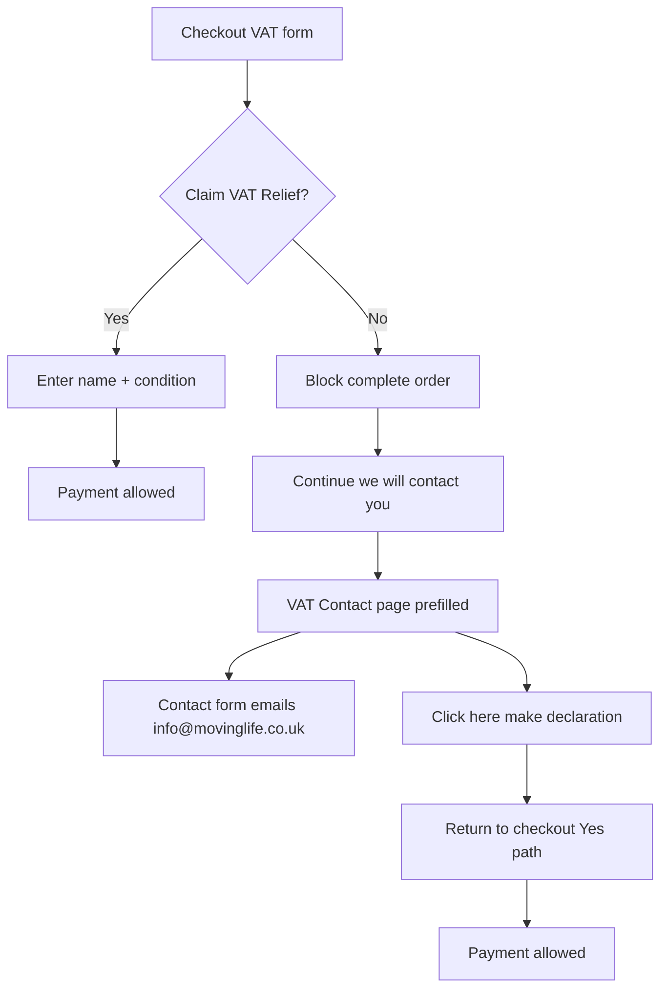

# VAT Relief Checkout — Step-gated Plan

## Overview

Implement the MovingLife UK VAT Relief checkout flowchart in gated steps: confirm + test each step before the next. Price never changes on Yes/No; No blocks payment and hands off to a new theme Contact page; Yes requires name + condition then allows payment.

## Decisions locked

- **Price:** stays the same for Yes and No (disable current `vat-transform` price ×1.20 logic).
- **Contact page:** create a new Shopify theme page (theme access available; no theme repo in this workspace yet — we will pull/push via Shopify CLI).

## Current baseline

- [`extensions/vat-selector/src/Checkout.jsx`](extensions/vat-selector/src/Checkout.jsx) — Yes/No choice list → cart attribute `_vat_relief_reason` only.
- [`extensions/vat-transform/src/cart_transform_run.ts`](extensions/vat-transform/src/cart_transform_run.ts) — changes line prices (conflicts with flowchart; will be neutralized).
- No declaration fields, no checkout block, no Contact page, no email handoff.

## Target flow

## Working rule (how we execute)

Each step below ends with **STOP → you confirm/test on checkout/dev store → say "next"**. No coding of Step N+1 until Step N is signed off.

## Checklist

- [ ] Step 0: Pull theme, create VAT Contact page + form; confirm email to `info@movinglife.co.uk`
- [x] Step 1: Make `vat-transform` a no-op; fix tests; confirm prices unchanged (code done — awaiting your checkout confirm)
- [x] Step 2: Add eligible person name + condition fields; save cart attributes (code done — awaiting your checkout confirm)
- [x] Step 3: UI intercept + Validation function to block No / incomplete Yes (code done — awaiting your checkout confirm)
- [ ] Step 4: Continue CTA opens Contact page with name/phone/email/postcode prefills
- [ ] Step 5: Final B5 copy, declaration link back to checkout, full E2E test

---

### Step 0 — Theme access + Contact page shell

**Do:** Connect to MovingLife store theme via Shopify CLI (`shopify theme pull` / identify live theme). Create a new page template (e.g. `page.vat-relief-enquiry.json` + section) with:

- Placeholder copy matching flowchart B5
- Standard Shopify `` fields (name, phone, email, postcode, message)
- "Click here (Make a declaration)" link pointing back to checkout cart URL
- Note for merchant: store **Customer email / contact recipient** must be `info@movinglife.co.uk` (Shopify contact form uses shop notification email)

**Test:** Publish draft theme / preview URL; open page; submit form; confirm email arrives at `info@movinglife.co.uk`.

**Confirm before Step 1.**

---

### Step 1 — Neutralize price changes (flowchart: price stays the same)

**Do:** Change [`cart_transform_run.ts`](extensions/vat-transform/src/cart_transform_run.ts) to return `{ operations: [] }` always (no price/title mutation). Update Vitest fixtures to match. Keep the function installed so we can optionally reintroduce title-only labels later without re-enabling pricing.

**Test:** Checkout with Yes and No — line prices identical to catalog; no "(with VAT)/(without VAT)" title rewrite.

**Confirm before Step 2.**

---

### Step 2 — Yes path declaration fields in checkout

**Do:** Extend [`Checkout.jsx`](extensions/vat-selector/src/Checkout.jsx):

- Keep Claim VAT Relief? choices (existing `yes_*` / `no_*` values).
- When selected value starts with `yes`: show **Eligible person name** (text) + **Condition** (select from list).
- Persist via cart attributes, e.g. `_vat_relief_name`, `_vat_relief_condition` (clear when switching to No).
- Default UK VAT-relief condition list (e.g. arthritis, blindness, cancer, cerebral palsy, cystic fibrosis, deafness/hearing impairment, diabetes, epilepsy, heart disease, HIV/AIDS, multiple sclerosis, muscular dystrophy, Parkinson's, respiratory condition, spinal injury, stroke, other — adjustable after your review).

**Test:** Select Yes → fields appear → fill → attributes visible in cart/order attributes; switch to No → fields hide and name/condition cleared.

**Confirm before Step 3.**

---

### Step 3 — Block checkout when No (or incomplete Yes)

**Do:**

1. Enable `block_progress` on [`vat-selector/shopify.extension.toml`](extensions/vat-selector/shopify.extension.toml).
2. In UI: `buyerJourney.intercept` — block when reason is `no_*`, or when `yes_*` but name/condition empty; allow when Yes + name + condition filled. Show clear error in the VAT form (payment methods remain visible).
3. Add a **Cart and Checkout Validation** function extension (server-side) reading the same cart attributes — so Express/Shop Pay / agentic checkouts cannot bypass the UI block. Allow only when `_vat_relief_reason` starts with `yes` AND name + condition present.

**Test:**

- No selected → Pay / Complete blocked; payment options still visible.
- Yes without name/condition → blocked.
- Yes with both filled → payment allowed, order completes.

**Confirm before Step 4.**

---

### Step 4 — No-path CTA → Contact page with prefills

**Do:** When No is selected, in the VAT block show primary button **"Continue — we will contact you"** (does not auto-redirect). On click, open Contact page URL with query params from checkout session: `name`, `phone`, `email`, `postcode` (from buyer identity / shipping address APIs). Contact page Liquid reads params and prefills inputs. Button does **not** complete checkout.

**Test:** Select No → click CTA → Contact page opens with fields prefilled from checkout; checkout still blocked if they return without declaring Yes.

**Confirm before Step 5.**

---

### Step 5 — Contact page message + declaration loop

**Do:** Finalize B5 copy on the Contact page:

> Unfortunately we aren't able to process VAT receipts online. Someone will contact you in the next 24 hours to process the order. If you have a long term medical condition, click here to make a declaration to avoid any delays.

Wire **"click here"** → return to checkout (same cart). On that same Contact page, keep the contact form submit → email to store (`info@movinglife.co.uk`). Declaration happens **only** in checkout VAT form (Yes + name + condition) — Contact page never replaces declaration.

**Test end-to-end:**

1. No → blocked → Continue → Contact → submit form → email received.
2. Click declaration link → checkout → select Yes + name + condition → payment succeeds.

**Confirm — done.**

---

## Out of scope / notes

- No automatic VAT price removal on Yes (per choice A).
- Condition list is a starter set; editable after Step 2 review.
- Merchant must place the `vat-selector` block in Checkout Editor and allow **block progress** for the extension.
- Theme path is not in this repo yet — Step 0 starts by locating/pulling the live theme.
